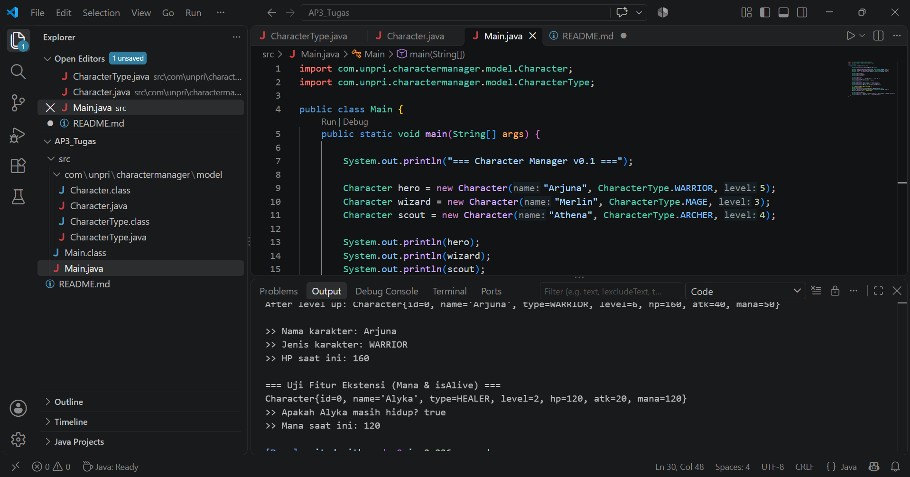

# Character Manager — TP3 (Java Visual SIH-6406)

Character Manager adalah aplikasi berbasis konsol Java yang dirancang untuk mengelola data karakter game (seperti Warrior, Mage, Archer, dan Healer) dengan menerapkan konsep Object-Oriented Programming (OOP) seperti enkapsulasi, enum, konstruktor ganda, dan validasi data.

## 📸 Screenshot Output Terminal



## 📁 Struktur Folder Project

```text
AP3_Tugas/
├── Screenshot 2026-10-16 011802.png
├── README.md
└── src/
    ├── Main.java
    └── com/
        └── unpri/
            └── charactermanager/
                └── model/
                    ├── Character.java
                    └── CharacterType.java

Nama    : Alyka Shakira Lubis
Nim     : (253303621239)
Kelas   : Semester 3 Pagi A
Link Google Docs : https://docs.google.com/document/d/1NfQNNXsIrucDt7KqxUM5YLN8f7SzGLRA_5qK-nVlh0g/edit?usp=sharing
